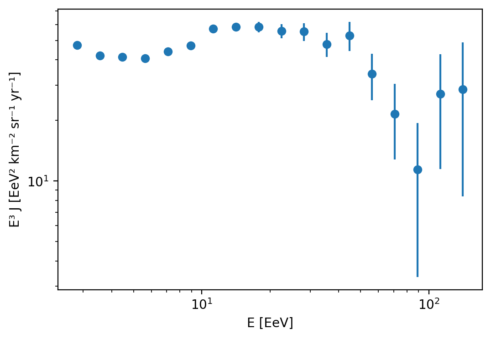

# Cosmic-ray energy spectrum from Pierre Auger Open Data

A first analysis of the ultra-high-energy cosmic-ray spectrum using the
public 10% data release of the Pierre Auger Observatory (SD-1500 array).

## Goal
The cosmic-ray flux falls steeply with energy, roughly as $J(E) \propto E^{-\gamma}$.
Using the public 10% data release of the Pierre Auger Observatory, I built the
energy spectrum above $2.5\ \mathrm{EeV}$ ($1\ \mathrm{EeV} = 10^{18}\ \mathrm{eV}$)
and measured how the spectral index $\gamma$ changes across the ankle and the
high-energy suppression.

## Data
Pierre Auger Observatory Open Data (Zenodo, CC BY-SA 4.0).
Files used: `summary/dataSummarySD1500.csv` and `auxiliary/sd1500exposure.csv`.
The data are not included here. Download them from the Zenodo page and place
the zip files in `data/`.

## Method
1. Select events from the SD-1500 array with zenith angle $\theta \le 60^\circ$ and
   reconstructed energy $E \ge 2.5\ \mathrm{EeV}$, the range where the detector
   is fully efficient (following the selection in Auger's example notebook).
   This leaves 21,587 events.
2. Bin events in $\log_{10}E$ with width $0.1$, starting at
   $\log_{10}(E/\mathrm{eV}) = 18.4$ (as in Auger's example notebook).
3. Compute the flux in each bin as $J = N / (\mathcal{E}\,\Delta E)$, where $N$ is
   the number of events, $\Delta E$ the bin width and $\mathcal{E} = 6040.84\ \mathrm{km^2\,sr\,yr}$
   the total exposure of the 10% sample (from `sd1500exposure.csv`).
   $J$ is in $\mathrm{km^{-2}\,sr^{-1}\,yr^{-1}\,EeV^{-1}}$.
   Uncertainties are Poisson: $\sqrt{N}/(\mathcal{E}\,\Delta E)$.
4. Plot $E^3 J$ against $E$.
5. Fit power laws to $5$–$40\ \mathrm{EeV}$ and $40$–$150\ \mathrm{EeV}$ with `scipy.optimize.curve_fit`.

The event counts in the first bins (8325, 4661, 2891, 1798, 1223) agree with
those in Auger's example notebook to within a few events.

## Results

Plotted as $E^3 J$, the spectrum flattens around $5\ \mathrm{EeV}$ (the ankle) and
falls steeply above roughly $40\ \mathrm{EeV}$ (the suppression). The overall shape
matches the ankle and suppression reported by the Auger Collaboration.
Because only 10% of the data is public, the slope above $40\ \mathrm{EeV}$ is poorly
constrained: it changed from 5.04 to 4.54 to 4.71 as I adjusted the cuts and bin edges,
shifts of up to about one standard deviation.

- $5$–$40\ \mathrm{EeV}$: $\gamma = 2.75 \pm 0.03$ (statistical only)
- $40$–$150\ \mathrm{EeV}$: $\gamma = 4.71 \pm 0.57$ (statistical only)

## Limitations
- Only 10% of the data; very few events above about $60\ \mathrm{EeV}$.
- No energy-resolution correction or systematic uncertainties.
- Poisson errors are unreliable for bins with very few events.

## Run
Edit the `BASE` path at the top of `spectrum.py` to your own folder, then run
`python spectrum.py` (needs numpy, pandas, scipy, matplotlib).

## Acknowledgement
Data: Pierre Auger Collaboration, Open Data release.
